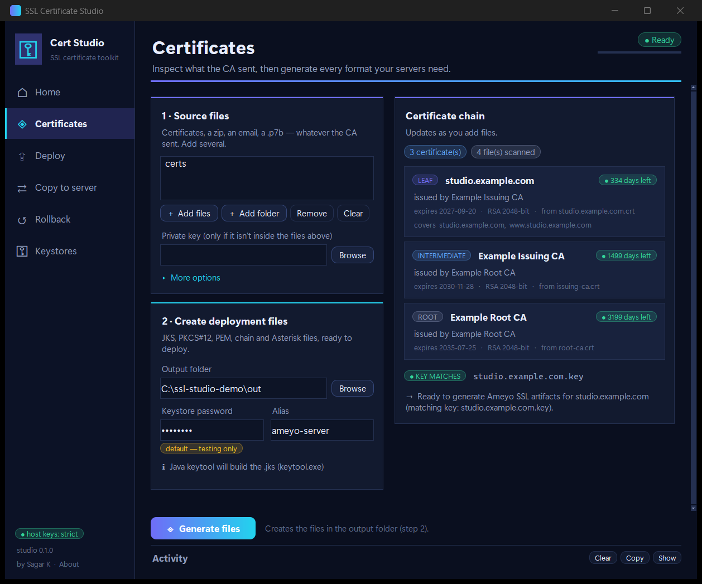

# ssl-auto — Universal SSL Certificate Tool

Generate deployment-ready certificates from ANY customer input format and deploy them to ANY server configuration via SSH. Cross-platform: **Windows, macOS, Linux**.

## Features

- **Universal input handling** — Parse certificates from emails (.eml), archives (.zip, .7z), documents (.docx), PKCS7 (.p7b), PKCS12 (.p12), PEM, DER, and more
- **Any domain** — Auto-detects domain from certificate CN
- **Any server setup** — Configure via YAML for any combination of servers and services
- **Multiple service types** — JKS (Java/Tomcat), Apache, Nginx, Asterisk, or custom
- **One command** — Generate artifacts + validate + deploy in a single run
- **Dry-run mode** — Preview all changes before deployment
- **Cross-platform** — Works identically on Windows, macOS, and Linux

## Quick Start

### Windows

```bat
setup.bat
python ssl-auto.py run --input "customer_certs/" --key "domain.key" --config deploy-config.yaml
```

### macOS / Linux

```bash
chmod +x setup.sh ssl-auto
./setup.sh
./ssl-auto run --input customer_certs/ --key domain.key --config deploy-config.yaml
```

## Commands

| Command | Description |
|---------|-------------|
| `run` | Full pipeline: parse -> generate -> validate -> deploy |
| `generate` | Generate artifacts only |
| `deploy` | Deploy existing artifacts |
| `inspect` | Inspect inputs without generating files |
| `init` | Create a new configuration file |
| `configs` | List available configurations |
| `validate` | Validate a configuration file |
| `plan` | Show deployment plan without changes |
| `rollback` | Restore files from the most recent (or a specific) pre-deploy backup (`--restart` also restarts the services) |
| `copy` | Copy cert/key files to a server like `scp`, but verified, atomic and reversible; works through jump hosts |
| `preflight` | Check each server's live `ameyoctl status` before deploying |

### Examples

```bash
# Generate + deploy (full automation)
python ssl-auto.py run --input certs/ --key domain.key --config myconfig.yaml

# Generate only, no deploy
python ssl-auto.py run --input certs/ --key domain.key --no-deploy

# Dry run (preview changes)
python ssl-auto.py run --input certs/ --key domain.key --config myconfig.yaml --dry-run

# Deploy existing certs to one server
python ssl-auto.py deploy --certs output/example.com/ --config myconfig.yaml --server web_server

# Create a new config
python ssl-auto.py init --name mycompany --domain example.com

# Validate config
python ssl-auto.py validate --config myconfig.yaml

# Show deployment plan
python ssl-auto.py plan --config myconfig.yaml --certs output/example.com/

# Undo the last deploy (restores the most recent pre-deploy backup)
python ssl-auto.py rollback --config myconfig.yaml

# Roll back one server to a specific snapshot
python ssl-auto.py rollback --config myconfig.yaml --server web_server --timestamp 20260916_143000
```

## Configuration

Create a YAML config file for each environment. See `configs/template.yaml` for documentation.

**Minimal example:**

```yaml
domain: ""  # Auto-detect from certificate

keystore:
  password: "changeit"
  alias: "server-cert"

servers:
  web_server:
    host: "192.168.1.10"
    user: "root"
    services: [tomcat]

services:
  tomcat:
    type: jks
    remote_path: /opt/tomcat/conf/keystore.jks
    restart: "systemctl restart tomcat"
```

### Service Types

| Type | Use for | Key fields |
|------|---------|------------|
| `jks` | Tomcat, Java apps | `remote_path`, `restart` |
| `apache` | Apache httpd | `ssl_dir`, `cert_file`, `key_file`, `chain_file` |
| `nginx` | Nginx | `cert_path`, `restart` |
| `asterisk` | Asterisk VoIP | `cert_dir`, `restart` |
| `custom` | Any service | `file_mappings` |

### Hooks & restart order (optional, any service type)

- `hooks:` — shell commands run once per host after that host's uploads succeed, before restarts (e.g. importing a cert into another store). Identical hook strings across services on the same server run only once.
- `priority:` — controls restart order when a server has multiple services (ascending, default `50`). Identical restart commands on the same server only run once.

Services on the same server that write to the **same remote path** (e.g. two Tomcat services sharing one keystore) are automatically uploaded, backed up, and hook-verified only once. See `configs/template.yaml` for a full example.

### Ameyo service catalogue

For Ameyo/CRM customers, `catalogues/ameyo.yaml` holds reusable role definitions (appserver, crm, acp, asterisk, ...) so a customer config only needs an `ameyo_profile:` block (SSL dir, JKS name/pass/alias, cacerts paths) plus `role: <name>` per service instead of writing hooks out by hand. See `configs/example-ameyo.yaml` for a full example, and the User Guide's "Ameyo service catalogue" section for details. (Not used by PyInstaller `.spec` builds yet — `catalogues/` needs adding to their bundled data if you package a release.)

### Pre-flight check

`preflight` (and `deploy`/`run` automatically, unless `--skip-preflight`) SSHes into each server and reads its live `ameyoctl status`, reporting which of the deploy's services are actually running there before you commit:

```bash
python ssl-auto.py preflight --config myconfig.yaml
```

### Backups & Rollback

Every file a deploy overwrites is snapshotted first, under `<backup_dir>/<server>/<timestamp>/<original path>` (default `backup_dir: /tmp/ssl-deploy-backups`; set `backup_dir:` in the config to somewhere durable, e.g. `/var/backups/ssl-auto`, if you want snapshots to survive a reboot). The backup directory must be a real directory owned by the SSH user; the tool creates it `0700` and refuses to deploy if it is owned by someone else. If a deploy goes wrong:

```bash
# Restore the most recent snapshot on every server
python ssl-auto.py rollback --config myconfig.yaml

# Preview first, or target one server / a specific snapshot
python ssl-auto.py rollback --config myconfig.yaml --dry-run
python ssl-auto.py rollback --config myconfig.yaml --server web_server --timestamp 20260916_143000

# Restoring files does not reload running services; add --restart to do that too
python ssl-auto.py rollback --config myconfig.yaml --restart
```

### SSH Authentication

- **SSH key**: Set `ssh_key: ~/.ssh/id_rsa` per server (recommended)
- **Password**: Set the `SSH_PASSWORD` env var, or reference one in the config with `password: ${env:MY_SSH_PW}`
- **ssh-agent**: Supported on macOS/Linux
- **Defaults for every server**: a top-level `ssh:` block (`user`, `port`, `key`, `host_key_policy`) is applied to servers that do not set their own.

### Host keys (man-in-the-middle protection)

Servers are only trusted if their host key is already known (`~/.ssh/known_hosts` or `~/.ssl-auto/known_hosts`). On first contact the tool **refuses** and prints the server's fingerprint:

```
Untrusted host key for 10.0.0.5: ssh-ed25519 SHA256:3qB...  Verify this fingerprint with the server owner, then ...
```

Verify that fingerprint out-of-band (e.g. `ssh-keygen -lf /etc/ssh/ssh_host_ed25519_key.pub` on the server), then choose one of:

```bash
# 1. Trust it once and remember it (trust-on-first-use)
python ssl-auto.py preflight --config myconfig.yaml --accept-new-hostkeys
```

```yaml
# 2. Pin the fingerprint in the config (no known_hosts entry needed)
servers:
  web_server:
    host: 10.0.0.5
    host_key_sha256: "SHA256:3qB..."
```

A server whose key has **changed** is always refused, even with `--accept-new-hostkeys`.

### Reaching servers through jump hosts (bastions)

Servers that can only be reached through a bastion work like `ssh -J`. Either reuse your existing
`~/.ssh/config` (its `ProxyJump` chain is followed), or list the hops in the config:

```yaml
servers:
  jana_app:
    ssh_alias: app-server-1   # HostName/Port/User/ProxyJump come from ~/.ssh/config
    services: [crm]
  app_by_hand:
    host: 10.128.0.7
    user: deploy
    port: 142
    proxy_jump: [jump-host, edge-nginx]       # server names from this file, ssh-config aliases, or user@host:port
    services: [crm]
```

- Every hop is host-key verified with the same policy (`--accept-new-hostkeys`, `host_key_sha256` per hop).
- **Each hop has its own password**: the hop's `password:`, `SSH_PASSWORD_<NAME>` (e.g. `SSH_PASSWORD_AOC_JUMP`),
  or `--ask-ssh-password`, which prompts (hidden) once per `user@host`, and only after that host refused your
  keys/agent. A target's password is never offered to a jump host.
- Explicit settings in the config beat `~/.ssh/config`, which beats the `ssh:` defaults.
- Not supported: `ProxyCommand`, and one-time-code (keyboard-interactive / 2FA) prompts. The jump host must allow
  TCP forwarding (the same requirement as `ssh -J`).

### Copying files to a server (scp-like)

`copy` pushes files with the same safety as a deploy: each file is checksum-verified, written atomically, keeps the
owner of the file it replaces, and the old version is backed up first. A key must match its certificate and the
certificates must be in date, or nothing is sent (`--skip-verify` overrides).

```bash
ssl-auto copy --host app-server-1 --ask-ssh-password \
    --file out/x.com/main_x.com.crt:/home/deploy/certs/x.crt \
    --file out/x.com/x.com.key:/home/deploy/certs/x.key \
    --check-cmd 'test -s /home/deploy/certs/x.crt' \
    --dry-run                       # drop --dry-run to do it for real
```

| Option | Meaning |
|--------|---------|
| `--file SRC:/remote/path[:MODE]` | Repeat per file. Default mode: `600` for private keys, `644` otherwise. A key is never left world-accessible; group access (`:640`) is allowed when you ask for it |
| `--host HOST` | An alias from `~/.ssh/config`, or `[user@]host[:port]` |
| `--via HOP[,HOP...]` | Jump host(s) for `--host` |
| `--server NAME --config FILE` | Use a server defined in a deploy config instead |
| `--check-cmd CMD` | Runs on the server after copying; if it fails, **everything copied is restored** (e.g. `nginx -t`) |
| `--reload-cmd CMD` | Runs after a successful copy and check (e.g. `systemctl reload nginx`); failure is reported, not undone |
| `--backup-dir DIR` | Backup folder on the server (default `/tmp/ssl-auto-backups-<user>`) |

The destination must be writable by the SSH user (there is no `sudo`): copy to a folder you own and move it into
place, or log in as a user that can write there. In Git Bash, `a.crt:/home/x` is rewritten as a Windows path list;
use PowerShell, or prefix the command with `MSYS_NO_PATHCONV=1`.

### What the tool checks before and after it deploys

1. **Before anything is uploaded** the certificate files are verified locally: the private key must match the certificate, the certificate must be currently valid (warning under 14 days), cover the configured `domain`, and the supplied chain must contain its issuer. A failure stops the whole deploy with a non-zero exit code (`--skip-verify` overrides).
2. **Uploads are atomic and verified**: each file goes to a `0600` temp file, is size/SHA-256 checked, then renamed into place, keeping the owner of the file it replaces and following a symlinked destination. Private keys are never written group/world-readable.
3. **A failing service is undone**: if any file of a service fails, the files already replaced for that service are restored.
4. **Hooks are gates**: if a post-upload hook fails (e.g. `jks_verify`, `keypair_check`), the services are *not* restarted and the files are restored (`--no-auto-rollback` keeps them in place).
5. **JKS services** are opened with the configured password/alias on the server before restart (password via stdin, never on a command line).
6. **Optional live check** after restart: add `verify_tls: {port: 8443}` to a service and the tool handshakes with it and confirms it serves the new certificate.

All remote paths must be absolute, and every path/argument is shell-quoted.

### Keeping secrets out of the command line and the repo

| Secret | Preferred way |
|--------|---------------|
| Keystore password | `--password-env VAR` / `--password-file FILE`, or `keystore.password: ${env:VAR}` in the config |
| SSH password | `SSH_PASSWORD` env var or `password: ${env:VAR}` |
| Encrypted private key passphrase | `--key-password` or `SSL_KEY_PASSWORD` (prompted for on a terminal) |

`-p/--password` still works but is visible in the process list. The tool masks known passwords in its own output, passes the password to `keytool` through the environment, and writes generated keys, PKCS#12 and `asterisk.pem` files `0600`. Run `python ssl-auto.py validate --config ...` to get warnings about plaintext secrets and the default `changeit` password.

> **Known limitation:** hooks from the Ameyo catalogue (`cacerts_import`, `jks_verify`) still embed the keystore password in the remote command line, so it is briefly visible to other local users on that server. Treat that password accordingly.

## Options

| Flag | Description |
|------|-------------|
| `--dry-run` | Show what would happen without making changes |
| `--no-deploy` | Generate only (with `run`) |
| `--no-restart` | Deploy files but skip service restarts |
| `--server NAME` | Deploy to one server only |
| `--service NAME` | Deploy one service only |
| `--parallel` | Deploy to multiple servers in parallel |
| `--accept-new-hostkeys` | Trust and remember host keys of servers not yet in known_hosts (a changed key is still refused) |
| `--known-hosts FILE` | known_hosts file the tool reads/writes (default `~/.ssl-auto/known_hosts`) |
| `--ask-ssh-password` | Prompt (hidden) for an SSH password when a host refuses your keys/agent; asked once per `user@host` |
| `--ssh-config FILE` | OpenSSH config used to resolve `ssh_alias` / `proxy_jump` names (default `~/.ssh/config`) |
| `--skip-verify` | Deploy even if the pre-deploy certificate/key checks fail |
| `--no-auto-rollback` | Keep files in place if a post-upload hook fails |
| `--skip-preflight` | Skip the live `ameyoctl status` pre-flight |
| `--password-env VAR` / `--password-file FILE` | Read the keystore password from the environment / a file |
| `--key-password TEXT` | Passphrase for an encrypted private key (or `SSL_KEY_PASSWORD`) |
| `--no-color` | Disable colored output |

## Generated Output

For domain `example.com`, generates in `output/example.com/`:

| File | Purpose |
|------|---------|
| `example.com.jks` | Java keystore |
| `main_example.com.crt` | Leaf certificate |
| `intermediate_example.com.crt` | CA chain |
| `example.com.key` | Private key |
| `example.com.pem` | Full chain PEM |
| `chain.crt` | Apache CA bundle |
| `asterisk_example.com.crt` | Asterisk cert chain (certs only) |
| `asterisk_example.com.pem` / `asterisk.pem` | Ameyo Asterisk combined PEM (key + leaf + intermediate + root) |
| `keystore.p12` | PKCS12 keystore |

## Supported Input Formats

`.crt`, `.cer`, `.pem`, `.p7b`, `.p7c`, `.p12`, `.pfx`, `.eml`, `.docx`, `.txt`, `.zip`, `.7z`, `.ca-bundle`, `.der`, base64-only files, combined key+cert files, folders.

Archives are treated as untrusted: paths that escape the extraction folder, symlinks, and archives that expand beyond 2,000 entries / 256 MB are rejected (other files in the same folder are still processed). RSA, EC and Ed25519 keys are supported; encrypted keys need `--key-password`.

## Requirements

- Python 3.9+
- Java is **optional**: `.jks` files are made with Java's `keytool` when it is installed, otherwise with the built-in JKS writer
- SSH access to target servers (for deploy)

Run `python setup.py` to install Python dependencies and verify tools.

## SSL Certificate Studio (new GUI, preview)

A redesigned desktop app for the same jobs as the CLI, in a dark theme with step-by-step pages.



*Demo data, taken on Windows 11. More screenshots and a page-by-page tour are in [docs/STUDIO.md](docs/STUDIO.md).*

```bash
python ssl-gui2.py                  # opens on Home (use `py` on Windows, `python3` on macOS/Linux)
python ssl-gui2.py --page deploy    # or: home, certs, deploy, copy, rollback, keystore
python ssl-gui2.py --no-state       # do not read or remember anything (folders, last config)
```

It needs Python 3.9+ **with Tkinter** and `pip install -r requirements.txt`. Tkinter is bundled with the Windows and
python.org macOS installers; on Linux install it first (`sudo apt install python3-tk` on Debian/Ubuntu,
`sudo dnf install python3-tkinter` on Fedora/RHEL/Rocky, `sudo pacman -S tk` on Arch, `sudo zypper install python3-tk`
on openSUSE) and with Homebrew use `brew install python-tk`. Per-OS steps and troubleshooting are in
[docs/STUDIO.md](docs/STUDIO.md).

| Page | What it does |
|---|---|
| Certificates | Add certificate/key/archive files, see each certificate's chain, expiry and whether the key matches, then generate the deployment files |
| Deploy | Pick a config and a certificate folder, see the plan per server, preview, then deploy |
| Copy to server | scp-like copy through jump hosts; the route is drawn as you type the host |
| Rollback | Restore the previous files from the last (or a chosen) backup |
| Keystores | Open a `.jks`/`.p12` and see the alias, domain, issuer, expiry and chain |

It calls the same code as the CLI, needs nothing beyond what `ssl-auto` already needs plus Tkinter, and
keeps the same safety rules: dry run is on by default, live actions ask first, SSH host keys are verified, and passwords
are typed into a hidden dialog and never stored. The classic `ssl-gui.py` is unchanged and is still what the packaged
executables launch.

## Standalone executables (no Python, no Java)

`build-windows.bat` (and `build-mac.sh` / `build-linux.sh` on those systems) produce a self-contained
`ssl-auto` CLI and a `SSLCertTool` GUI via PyInstaller, in a versioned folder (`dist/SSLCertTool-Windows-v<version>/`)
plus a ZIP. PyInstaller cannot cross-compile, so build on each target OS. The script bundles the Ameyo
`catalogues/` and **only** the template and example configs (never your customer configs), smoke-tests the
result, and writes `SHA256SUMS.txt`:

```bash
sha256sum -c SHA256SUMS.txt        # Linux / macOS / Git Bash
certutil -hashfile ssl-auto.exe SHA256   # Windows, compare by eye
```

Executables are unsigned unless you sign them, so Windows SmartScreen/antivirus may warn on first run.

## Development & tests

```bash
pip install -r requirements.txt -r requirements-dev.txt
python -m pytest
```

The suite covers key/cert matching, hostile archives, `keytool` password handling, the deployer against a fake remote host (atomic upload, backup/revert, hooks, rollback, quoting/injection), and host-key verification against a real in-process SSH server. Checks that depend on POSIX file modes and symlinks are skipped on Windows and run on Linux/macOS (see `.github/workflows/tests.yml`).

## Directory Structure

```
ssl-cert-tool/
|-- ssl-auto.py               # Main entry point
|-- ssl-auto.bat              # Windows launcher
|-- ssl-auto / ssl-auto.command   # Unix launchers
|-- configs/                  # Configuration files
|   |-- template.yaml         # Blank template with docs
|   |-- example-simple.yaml   # Single server example
|   `-- example-multiserver.yaml
|-- deploy-config.yaml        # Active/default config
|-- ssl_cert_tool/            # Certificate parsing & generation
|   |-- core.py
|   |-- fsutil.py             # private-file writes, atomic replace
|   `-- platform.py
|-- ssl_deploy/               # SSH deployment
|   |-- deployer.py           # orchestration, backup/revert, rollback
|   |-- ssh.py                # host-key policy, quoting, command runner
|   `-- verify.py             # pre-deploy checks, live TLS check
|-- ssl-gui.py                # classic GUI
|-- ssl-gui2.py               # SSL Certificate Studio (new GUI, preview)
|-- ssl_ui/                   # Studio: theme, widgets, pages, services, task runner
|-- tests/                    # pytest suite
|-- setup.py / setup.bat / setup.sh
|-- QUICK_START.md
|-- USER_GUIDE.md
`-- requirements.txt
```

## Documentation

- [QUICK_START.md](QUICK_START.md) — 5-step setup guide
- [USER_GUIDE.md](USER_GUIDE.md) — Full documentation
- `configs/template.yaml` — Configuration reference
- [CHANGELOG.md](CHANGELOG.md) — What changed in each release

## License

MIT, see [LICENSE](LICENSE). Created by Sagar K.
