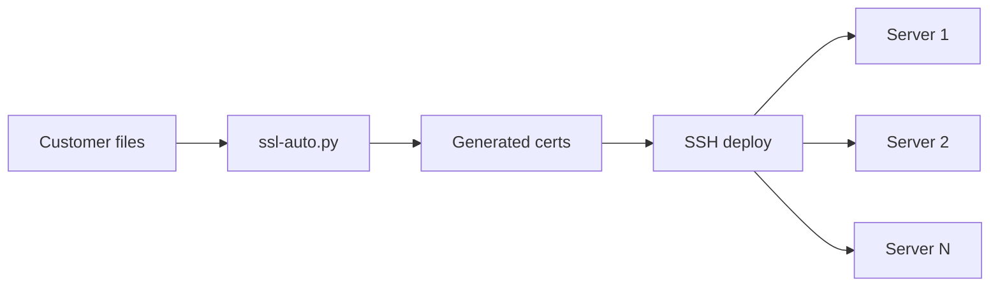

# SSL Certificate Tool — User Guide

Universal SSL certificate generation and deployment tool for any domain and server setup.

---

## 1. What problem does this solve?

Customers send SSL certificates in many different formats — email attachments, ZIP files, Word documents, or loose files with confusing names. Your servers need specific file types (JKS, PEM, CRT files) in specific folders. This tool takes **whatever the customer sends** and turns it into the right files, then copies them to the right places via SSH.

---

## 2. Big picture — two steps

```
Step 1: GENERATE certs  (on your laptop)
Step 2: DEPLOY certs    (to servers via SSH)
```

Or do both in **one command** with `ssl-auto.py run`.



---

## 3. Supported input formats

| What customers send | Examples |
|---------------------|----------|
| GlobalSign/DigiCert email | `.eml` file with certificate email |
| ZIP/archive | `.crt` + `.ca-bundle` + `.key` inside |
| Separate files | `example.com.crt`, intermediate, root |
| Word doc | `.docx` with PEM blocks pasted inside |
| Mixed folder | Any combination of the above |

**You always need the private key** (`.key` file), usually sent separately.

Supported extensions: `.crt`, `.cer`, `.pem`, `.p7b`, `.p12`, `.pfx`, `.ca-bundle`, `.eml`, `.txt`, `.docx`, `.zip`, `.7z`, folders.

---

## 4. What gets created

For domain `example.com`, files appear in `output/example.com/`:

| Generated file | Purpose |
|----------------|---------|
| `example.com.jks` | Java keystore (Tomcat, Spring Boot, etc.) |
| `main_example.com.crt` | Leaf/server certificate |
| `intermediate_example.com.crt` | Intermediate CA chain |
| `example.com.key` | Private key (copied) |
| `example.com.pem` | Full chain (certs only: leaf + intermediates) |
| `chain.crt` / `crm-ca.crt` | CA bundle for Apache (intermediate only) |
| `{domain}.ca-bundle` | Legacy Ameyo CA bundle (intermediate + root, like old `*.ca-bundle`) |
| `asterisk_example.com.crt` | Asterisk cert chain (certs only) |
| `asterisk_example.com.pem` / `asterisk.pem` | **Ameyo Asterisk deploy PEM**: private key first, then leaf + intermediate (+ root if available). Copy to server as `asterisk.pem` for `http.conf` `tlscertfile`. |
| `keystore.p12` | PKCS12 keystore |

---

## 5. Quick setup for a new customer

### Step 1: Create a configuration

```bash
python ssl-auto.py init --name mycustomer --domain example.com
```

This creates `configs/mycustomer.yaml`. Edit it to add your servers:

```yaml
domain: example.com

keystore:
  password: "your-password"  # Change this!
  alias: "server-cert"

servers:
  web_server:
    host: "192.168.1.10"
    user: "root"
    services:
      - tomcat

services:
  tomcat:
    type: jks
    remote_path: /opt/tomcat/conf/keystore.jks
    restart: "systemctl restart tomcat"
```

### Step 2: Validate the config

```bash
python ssl-auto.py validate --config mycustomer
```

### Step 3: Run the tool

```bash
python ssl-auto.py run \
  --config mycustomer \
  --input "/path/to/customer/certs" \
  --key "/path/to/private.key"
```

---

## 6. Commands reference

| Command | Description |
|---------|-------------|
| `run` | Full pipeline: parse → generate → validate → deploy |
| `generate` | Generate artifacts only (no deploy) |
| `deploy` | Deploy existing artifacts |
| `inspect` | Inspect inputs without generating files |
| `init` | Create a new configuration file |
| `configs` | List available configurations |
| `validate` | Validate a configuration file |
| `plan` | Show deployment plan without changes |
| `rollback` | Restore files from the most recent (or a specific) pre-deploy backup |
| `preflight` | Check each server's live `ameyoctl status` before deploying |
| `check-old` | Inspect existing JKS/cert (local or remote) |
| `compare` | Compare old and new certificates |

### Examples

```bash
# Full automation
python ssl-auto.py run --input certs/ --key domain.key --config myconfig

# Generate only (no deploy)
python ssl-auto.py run --input certs/ --key domain.key --no-deploy

# Dry run (preview changes)
python ssl-auto.py run --input certs/ --key domain.key --config myconfig --dry-run

# Deploy existing certs
python ssl-auto.py deploy --certs output/example.com/ --config myconfig

# Inspect customer files
python ssl-auto.py inspect --input "Customer Certs/" --key domain.key

# List available configs
python ssl-auto.py configs

# Show deployment plan
python ssl-auto.py plan --config myconfig --certs output/example.com/

# Undo the last deploy (restores the most recent pre-deploy backup)
python ssl-auto.py rollback --config myconfig

# Roll back one server to a specific snapshot, preview first
python ssl-auto.py rollback --config myconfig --server web_server --dry-run
python ssl-auto.py rollback --config myconfig --server web_server --timestamp 20260916_143000

# Check live ameyoctl status before deploying (also runs automatically
# before `deploy`/`run`, unless --skip-preflight is passed)
python ssl-auto.py preflight --config myconfig

# Generate with custom alias and password
python ssl-auto.py generate --input certs/ --key domain.key --alias "ameyo-server" --password "mypass"

# Check existing keystore
python ssl-auto.py check-old --jks /path/to/old.jks --password "oldpass"

# Check remote keystore via SSH
python ssl-auto.py check-old --remote server:/dacx/ssl2025/old.jks --config asnb

# Compare old and new certs
python ssl-auto.py compare --old /path/to/old.jks --new output/domain/new.jks --password "pass"

# Import settings from old cert during renewal
python ssl-auto.py run --input new_certs/ --key domain.key --match-old /path/to/old.jks --config myconfig
```

---

## 6.1 Certificate Renewal Workflow

When renewing an existing certificate, you can import settings from the old keystore.

### Password/Alias Options

| Option | Short | Description |
|--------|-------|-------------|
| `--password` | `-p` | Keystore password (default: changeit) |
| `--alias` | `-a` | Keystore alias (default: server-cert) |
| `--store-pass` | | Alternative name for --password |

### Import from Existing Certs

| Option | Description |
|--------|-------------|
| `--from-old PATH` | Import alias from existing JKS/P12 file |
| `--old-password TEXT` | Password for old keystore |
| `--match-old PATH` | Match all settings (alias + password) from old JKS |

### Inspection Commands

| Command | Description |
|---------|-------------|
| `check-old --jks PATH` | Inspect local JKS/P12 keystore |
| `check-old --remote HOST:PATH` | Inspect keystore on remote server via SSH |
| `compare --old PATH --new PATH` | Compare two keystores side-by-side |

### Renewal Example

```bash
# Step 1: Check the old certificate
python ssl-auto.py check-old --jks /dacx/ssl2025/old.jks --password "<keystore-password>"

# Output:
# === Current Certificate Details ===
# Keystore: /dacx/ssl2025/old.jks
# Alias: ameyo-server
# Domain: example.com
# Issuer: GlobalSign RSA OV SSL CA 2018
# Valid from: 2024-07-01
# Expires: 2025-07-01  [Expires in 30 days]
# Key type: RSA 2048-bit

# Step 2: Generate new cert with same settings
python ssl-auto.py run \
  --input new_customer.eml \
  --key domain.key \
  --match-old /dacx/ssl2025/old.jks \
  --old-password "<keystore-password>" \
  --config asnb

# Step 3: Compare old and new
python ssl-auto.py compare \
  --old /dacx/ssl2025/old.jks \
  --new output/example.com/example.com.jks \
  --password "<keystore-password>"

# Output:
# === Certificate Comparison ===
#                     OLD                    NEW
# Domain:             example.com            example.com          [SAME]
# Alias:              ameyo-server           ameyo-server         [SAME]
# Issuer:             GlobalSign RSA OV...   GlobalSign RSA OV... [SAME]
# Expires:            2025-07-01             2027-01-16           [+564 days]
# Key type:           RSA 2048               RSA 2048             [SAME]
# Password works:     YES                    YES
#
# Ready for renewal: YES
```

### Remote Certificate Checking

Check certificates on production servers without downloading manually:

```bash
# Check cert on remote server (uses SSH settings from config)
python ssl-auto.py check-old \
  --remote asnb-app-db:/dacx/ssl2025/asnbcc.jks \
  --config asnb
```

---

## 7. Configuration guide

### Service types

| Type | Use for | Key config fields |
|------|---------|-------------------|
| `jks` | Tomcat, Java apps | `remote_path`, `restart` |
| `apache` | Apache httpd | `ssl_dir`, `cert_file`, `key_file`, `chain_file` |
| `nginx` | Nginx | `cert_path`, `cert_file`, `key_file` |
| `asterisk` | Asterisk VoIP | `cert_dir` |
| `custom` | Other services | `file_mappings` |

Any service type also accepts:

| Field | Purpose |
|-------|---------|
| `hooks` | Shell commands run once per host after uploads succeed, before restarts (e.g. importing a cert into another store). Identical hooks across services on the same server run once. |
| `priority` | Restart order on a server with multiple services (ascending, default `50`). Identical restart commands on the same server run once. |

Two services on the same server that write to the **same remote path** (e.g. two Tomcat services sharing one keystore) are uploaded, backed up, and hook-verified only once — see `configs/example-ameyo.yaml` for a full worked example.

### Ameyo service catalogue (`ameyo_profile:` / `role:`)

For Ameyo/CRM customers, writing every service by hand means re-pasting the same cacerts-import/keypair-check hook scripts for every service and every customer. Instead, add a top-level `ameyo_profile:` block with the customer-specific values, then reference a role per service:

```yaml
domain: example.com
keystore: {password: "changeit", alias: "ameyo-server"}

ameyo_profile:
  ssl_dir: /dacx/exampleSSL
  jks_name: emerge-server-keystore.jks
  ca_bundle_legacy: legacy-name.ca-bundle
  asterisk_keys: /etc/asterisk/keys
  # java_dir defaults to /usr/lib/jvm/java-1.8.0-amazon-corretto

servers:
  app: {host: app-server, services: [appserver, crm]}

services:
  appserver: {role: appserver}
  crm: {role: crm}
```

Each `role:` expands into a full service definition (type, `file_mappings`/`remote_path`, `hooks`, `priority`, `restart`) from `catalogues/ameyo.yaml`, substituting `${ssl_dir}`, `${jks_path}`, `${jks_pass}`, `${jks_alias}`, `${ca_bundle_legacy}`, `${keytool}`, `${cacerts}`, `${asterisk_keys}`, `${domain}`. Available roles: `appserver`, `tomcat_si`, `ameyoart`, `vla`, `ameyoreports`, `scripter`, `crm`, `acp`, `nginx`, `asterisk`, `certs_only`. Any field can be overridden explicitly alongside `role:` — explicit keys win over the catalogue's (e.g. `{role: vla, priority: 25}`).

Configs without `ameyo_profile:` (like `asnb.yaml`) are completely unaffected — the catalogue only expands services that opt in with `role:`.

### SSH authentication

1. **SSH key** (recommended): Set `ssh_key: ~/.ssh/id_rsa` per server
2. **Password**: Set the `SSH_PASSWORD` environment variable, or use `password: ${env:VAR}` in config (avoid plaintext passwords in the file)
3. **Host keys**: unknown servers are refused until you verify the fingerprint and re-run with `--accept-new-hostkeys` (or pin `host_key_sha256` in the config). See README → "Host keys".
3. **ssh-agent**: Supported on macOS/Linux

### Example configurations

See the `configs/` directory for examples:

- `template.yaml` — Blank template with documentation
- `example-simple.yaml` — Single server Tomcat
- `example-multiserver.yaml` — Multiple servers (web + app + VoIP)
- `asnb.yaml` — Real production example
- `example-ameyo.yaml` — Multi-role Ameyo example (shared keystore, cacerts import hook, ordered restarts)

---

## 8. Platform guide

| Platform | Setup | Path format |
|----------|-------|-------------|
| **Windows** | `setup.bat` | `"C:\Users\name\Downloads\..."` |
| **macOS** | `./setup.sh` | `/Users/name/Downloads/...` |
| **Linux** | `./setup.sh` | `/home/name/Downloads/...` |
| **WSL** | `./setup.sh` | `/mnt/c/Users/name/Downloads/...` |

The tool auto-converts paths between formats.

---

## 9. Troubleshooting

| Problem | Solution |
|---------|----------|
| `Missing dependencies: cryptography` | Run `setup.bat` or `./setup.sh` |
| Key does not match certificate | Use the correct `.key` file for that domain |
| JKS password FAIL | Check `keystore.password` in your config |
| SSH failed | Test: `ssh user@hostname` manually |
| `keytool` not found | Not an error: the built-in JKS writer is used. Install a JDK only if you want Java's own `keytool` |
| Config not found | Use full path or name: `--config asnb` |

---

## 10. Example configurations

### Single server with Tomcat

```yaml
domain: ""  # Auto-detect from cert

keystore:
  password: "changeit"
  alias: "tomcat"

servers:
  app_server:
    host: "192.168.1.10"
    user: "deploy"
    services: [tomcat]

services:
  tomcat:
    type: jks
    remote_path: /opt/tomcat/conf/keystore.jks
    restart: "systemctl restart tomcat"
```

### Multiple servers with different services

```yaml
domain: example.com

keystore:
  password: "secure-password"
  alias: "server-cert"

servers:
  web_server:
    host: web.example.com
    user: root
    services: [nginx]
  
  app_server:
    host: app.example.com
    user: deploy
    services: [tomcat]
  
  voip_server:
    host: voip.example.com
    user: root
    services: [asterisk]

services:
  nginx:
    type: nginx
    cert_path: /etc/nginx/ssl/
    restart: "systemctl reload nginx"
  
  tomcat:
    type: jks
    remote_path: /opt/tomcat/conf/keystore.jks
    restart: "systemctl restart tomcat"
  
  asterisk:
    type: asterisk
    cert_dir: /etc/asterisk/keys/
    restart: "asterisk -rx 'module reload res_pjsip.so'"
```

---

## 11. FAQ

**Q: Does it modify server configs (tomcat.conf, httpd.conf)?**
A: No — only copies certificate files.

**Q: Do I need Python on the servers?**
A: No — only on your local machine.

**Q: Can I deploy to one server only?**
A: Yes — use `--server server_name`.

**Q: Can I undo a deploy?**
A: Yes — every overwritten file is backed up first. Run `python ssl-auto.py rollback --config myconfig` to restore the most recent snapshot (or `--timestamp` for a specific one). Raw backups live at `/tmp/ssl-deploy-backups/<server>/<timestamp>/<original path>` on each server if you need to inspect them by hand.

**Q: What's the difference between `ssl-auto.py` and `ssl-pipeline.py`?**
A: Both generate certs. `ssl-auto.py` is the main tool with built-in deploy and more commands.

---

## 12. Visual flow

```
  CUSTOMER            YOUR LAPTOP                          SERVERS
  ─────────           ───────────                          ───────
  .eml / .crt    →    ssl-auto.py run    →    output/  →   Server 1 (Tomcat)
  .p7b / .zip         parse + validate                     Server 2 (Apache)
  .key (private)      build JKS/PEM/CRT                    Server 3 (Nginx)
                      deploy via SSH                        Server N (Asterisk)
```

**Config:** Define servers, services, and paths in YAML — see `configs/template.yaml`.

---

*Universal SSL automation tool — works with any domain, any server setup.*
