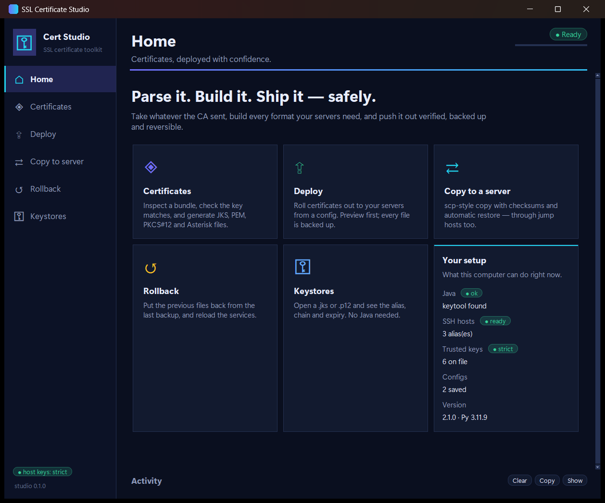
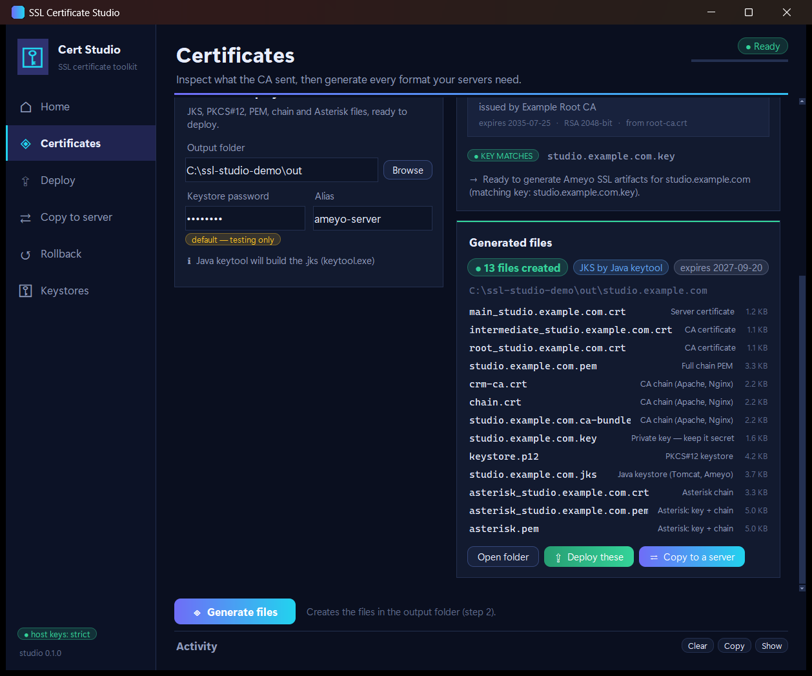
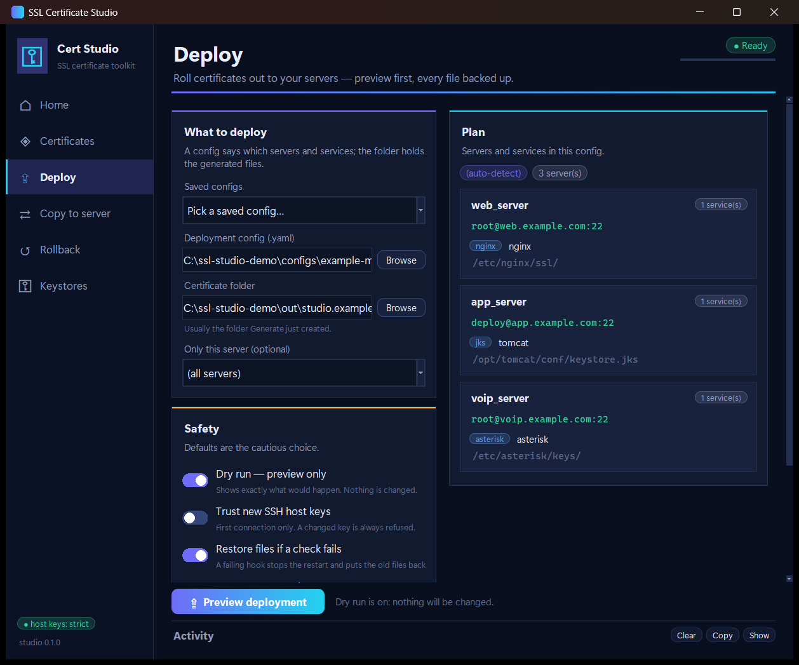
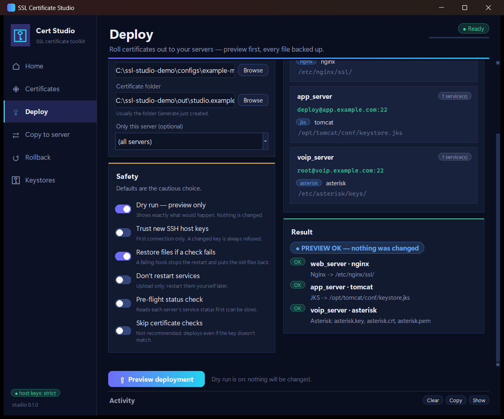
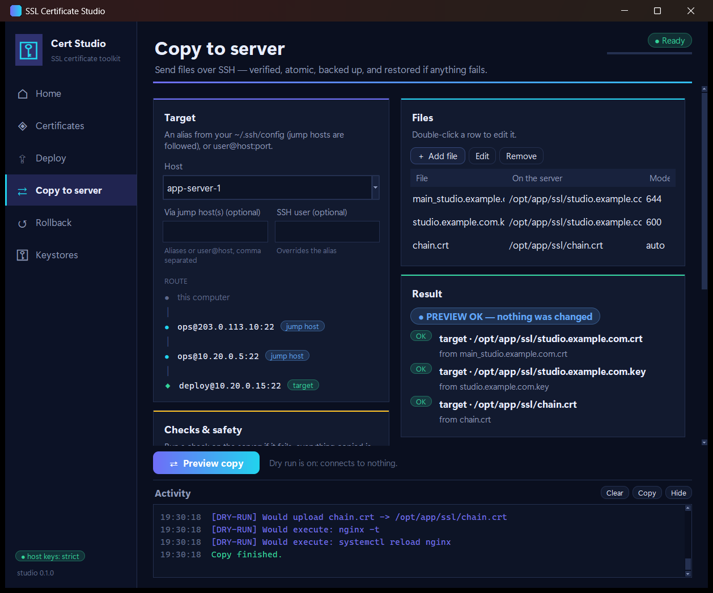
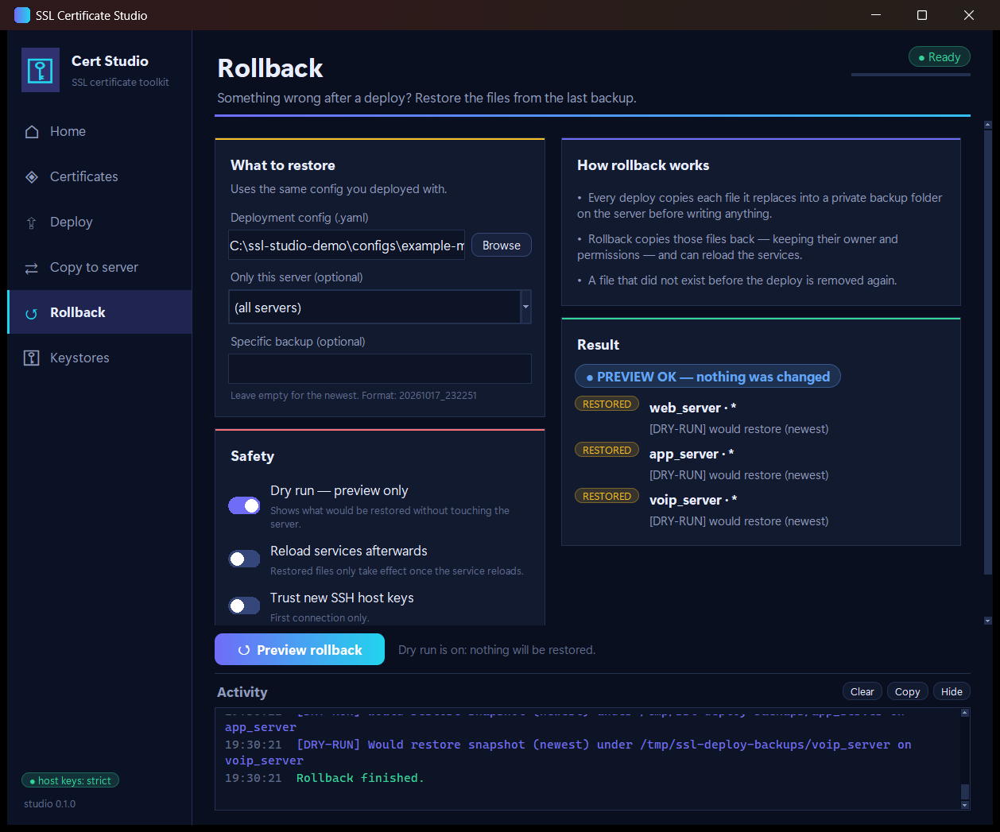
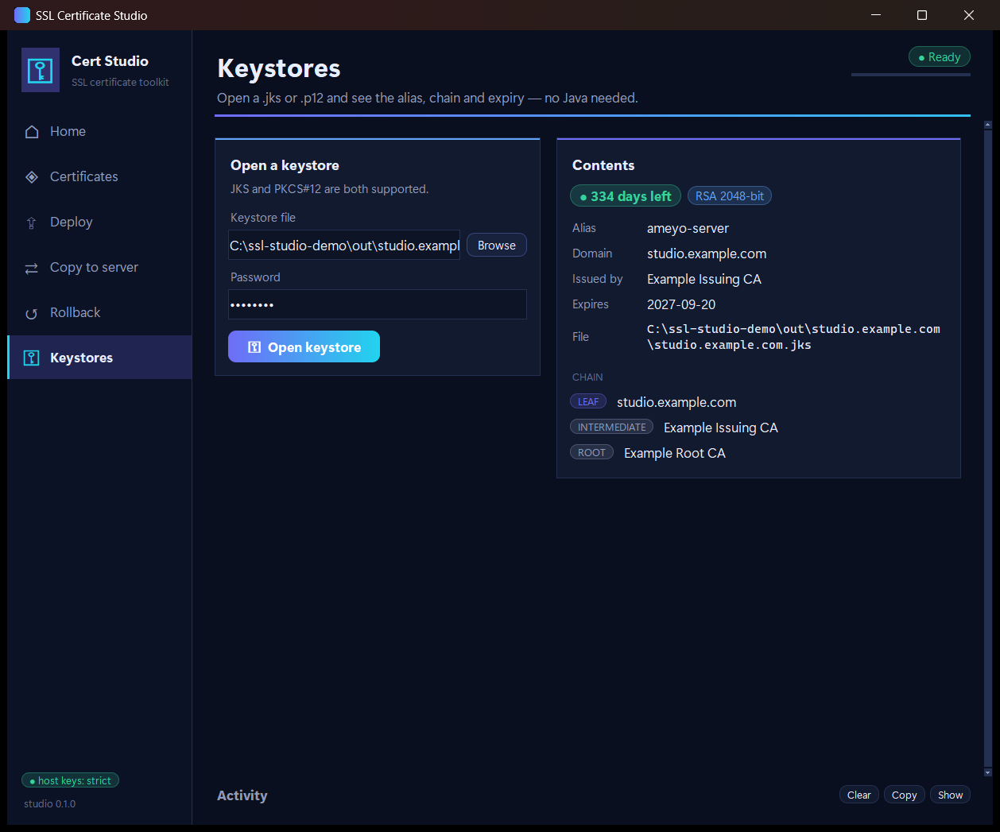

# SSL Certificate Studio

A desktop app for the same jobs as the `ssl-auto` command line: inspect the files a CA sent, build every format your
servers need, deploy them over SSH (through jump hosts too), copy files, roll back, and open keystores. It is the same
engine as the CLI with a window on top, so a deploy from the Studio behaves exactly like `ssl-auto deploy`.


> The screenshots on this page use made-up demo data (`studio.example.com`, a fake CA, generic server names) and were
> taken on Windows 11. The code is plain Tkinter, so it should look and behave the same on macOS and Linux, apart from
> fonts and the window frame. It has only been hand-tested on Windows so far; if something looks wrong elsewhere, please
> open an issue with a screenshot.

## Run it

You need Python 3.9 or newer **with Tkinter**, plus the packages in `requirements.txt` (`cryptography`, `paramiko`,
`PyYAML`). Nothing else: no Java, no web server, no extra GUI library.

Check that Tkinter works before anything else; this should open a small test window:

```bash
python3 -m tkinter
```

Then, from the folder you downloaded or cloned:

```bash
python3 ssl-gui2.py
```

Use `python` or `py` instead of `python3` on Windows. The window opens on **Home**.

Options:

| Option | What it does |
|---|---|
| `--page deploy` | Open straight on a page: `home`, `certs`, `deploy`, `copy`, `rollback`, `keystore` |
| `--no-state` | Don't read or remember anything (last folders, last config) |

### Windows

Install Python from [python.org](https://www.python.org/downloads/windows/) (Tkinter is included) or from the Microsoft
Store. In PowerShell or Command Prompt:

```powershell
cd path\to\ssl-cert-tool
py -m pip install -r requirements.txt
py ssl-gui2.py
```

### macOS

Use the Python from [python.org](https://www.python.org/downloads/macos/) (it bundles a current Tk). With Homebrew you
must add the Tk package for your Python version, for example `brew install python-tk@3.12`. Avoid the Python that ships
with the Xcode command line tools: it links an old Tk 8.5 that draws poorly.

```bash
cd path/to/ssl-cert-tool
python3 -m pip install -r requirements.txt
python3 ssl-gui2.py
```

### Linux

Install your distribution's Tkinter package, then use a virtual environment for the Python packages:

| Distribution | Install Tkinter |
|---|---|
| Debian, Ubuntu, Linux Mint | `sudo apt install python3-tk python3-venv` |
| Fedora | `sudo dnf install python3-tkinter` |
| RHEL, Rocky, AlmaLinux, CentOS Stream | `sudo dnf install python3-tkinter` (on version 8 install Python 3.9 or newer first, for example `python39 python39-tkinter`, and run `python3.9`) |
| Arch, Manjaro | `sudo pacman -S tk` |
| openSUSE | `sudo zypper install python3-tk` |
| Alpine | `sudo apk add py3-tkinter` |

```bash
cd path/to/ssl-cert-tool
python3 -m venv .venv
. .venv/bin/activate
pip install -r requirements.txt
python3 ssl-gui2.py
```

A graphical session is required (X11, or Wayland through XWayland). On a server with no desktop, use the command line
(`python3 ssl-auto.py --help`), or run the Studio on your own machine and reach the servers over SSH, which is what it is
built for. `ssh -X` should also work but is slow. On Windows 11, WSL2 with WSLg should be able to show the window too (untested).

## A tour

**Home** shows the five jobs and what this computer can do right now: whether Java's `keytool` is available (it isn't
needed), how many SSH aliases it found, and how many host keys are trusted.



**Certificates.** Add whatever the CA sent (certificates, a zip, an email, a `.p7b`). The right side shows the chain, who
issued each certificate, how many days are left, and whether the private key matches. Nothing is written until you press
*Generate files*.


*Generate files* builds the JKS, PKCS#12, PEM, chain and Asterisk files. From the result you can open the folder, send
the files to **Deploy**, or send them to **Copy to server**.



**Deploy** reads a config and shows the plan per server and service before anything happens. *Dry run* is on by default,
so the first press only previews.



The preview lists exactly what would be uploaded and restarted, and says "nothing was changed". Turn dry run off and the
button becomes *Deploy now*, which asks for confirmation first.



**Copy to server** is an scp-style copy with checksums, a backup of what it replaces, and an automatic restore if your
check command fails. Type a host or pick an alias from `~/.ssh/config`; the route through your jump hosts is drawn as you
type.



**Rollback** puts the previous files back from the last backup (or one you name), keeping owners and permissions, and can
reload the services.



**Keystores** opens a `.jks` or `.p12` and shows the alias, domain, issuer, expiry and chain. No Java needed.



## Safe by default

- Dry run is on for Deploy, Copy and Rollback. A live run asks for confirmation first.
- SSH host keys are verified. A new server is refused until you opt in with *Trust new SSH host keys*, and a changed key
  is always refused.
- SSH passwords are typed into a hidden dialog, once per `user@host`, only when keys and the agent were refused. They are
  never saved or logged.
- Only folders and file paths are remembered, in `~/.ssl-auto/studio.json`. That file refuses to store anything that looks
  like a password, token or secret.
- Work runs on a background thread, so the window never freezes during a deploy.

## Troubleshooting

| You see | Cause and fix |
|---|---|
| `ModuleNotFoundError: No module named 'tkinter'` | Your Python has no Tk. Install the package for your OS from the tables above. |
| `_tkinter.TclError: no display name and no $DISPLAY environment variable` | No graphical session (for example a plain SSH login). Run it on a desktop, or use the CLI. |
| `ModuleNotFoundError: No module named 'paramiko'` (or `cryptography`, `yaml`) | Run `pip install -r requirements.txt` in the same Python you launch with. |
| The window is blank or looks broken on macOS | You are on Tk 8.5. Use the python.org Python or `python-tk` from Homebrew. |
| *Preview* does nothing to the server | That is dry run, by design. Turn it off for a live run. |
| "Another task is still running" | One job runs at a time. Wait for the status pill in the corner to say *Ready*. |

## For developers

```text
ssl-gui2.py              entry point (calls ssl_ui.app.launch)
ssl_ui/app.py            the window: sidebar, header, activity log, navigation, background tasks
ssl_ui/pages/            one class per screen (home, certs, deploy, copy, rollback, keystore)
ssl_ui/services.py       plain functions the pages call; they call the real engine and return simple results
ssl_ui/runner.py         worker thread + queue, so the UI never blocks; also bridges password prompts
ssl_ui/widgets.py        buttons, pills, fields, dialogs        ssl_ui/theme.py   colours and fonts
ssl_cert_tool/, ssl_deploy/   the engine, shared with ssl-auto
```

A page never touches a server itself: it reads its form, then hands a job to `app.run_task(...)`, which runs a function
from `services.py` on the worker thread and calls back on the UI thread to show the result.

`tests/test_ui_widgets.py` drives the real window (every page and the full inspect, generate, deploy, copy, rollback and
keystore flows). It is skipped when there is no display; use `xvfb-run python -m pytest` on a headless Linux box. On
Windows, `python ssl-gui2.py --page deploy --screenshot out.png` saves a picture of the window and exits.
